# hapi_flutter — FHIR `Patient/$everything` in Flutter, against a HAPI FHIR server

[](https://flutter.dev)
[](https://hapifhir.io)
[](https://hl7.org/fhir/R4/)
[](https://hub.docker.com/r/hapiproject/hapi)
[](LICENSE)

> **Status:** 2024 technical demo for the [Carepal](https://github.com/supermax01/Carepal) project. It shows the
> end-to-end path from a FHIR server to typed Dart models and a patient summary screen. Not for clinical use.

## What it demonstrates

- A single `GET /fhir/Patient/{id}/$everything` call returns a FHIR `Bundle`; the app parses it into typed models
  (`lib/models/`) for **Patient, MedicationRequest, CarePlan, Condition, Observation, Encounter, Organization,
  Practitioner** and renders a patient summary: demographics, medications and dosage instructions, care plan,
  active conditions (e.g. liver cirrhosis), lab observations (e.g. serum bilirubin), encounters, organization,
  practitioner.
- The sample data uses standard terminologies: SNOMED CT for conditions and care-plan activities, LOINC for
  observations, UCUM for units.

## Screenshots

| iOS | Android |
|---|---|
| 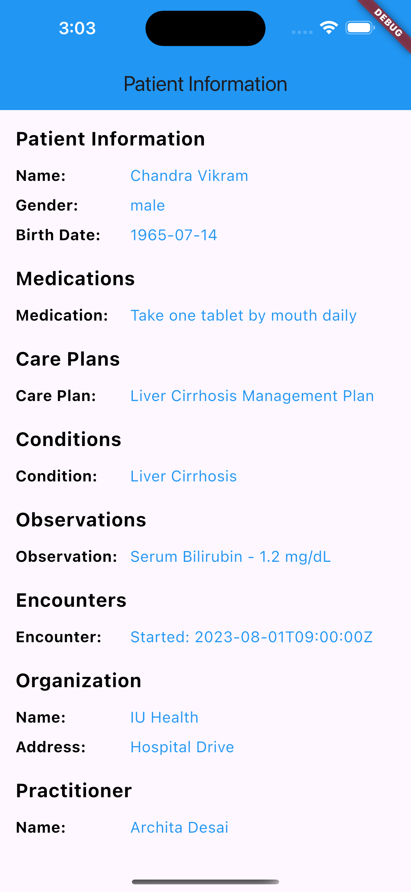 | 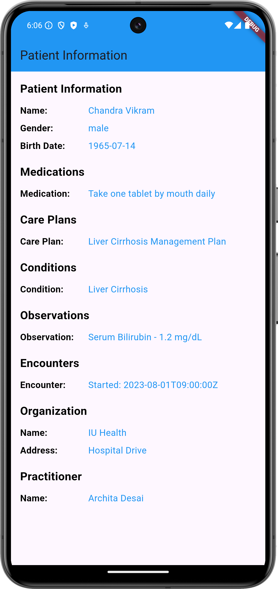 |

<details>
<summary>Carepal app design walkthrough (13 screens)</summary>
<br>

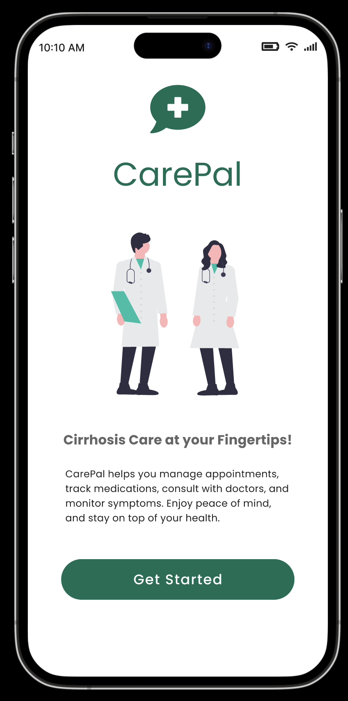
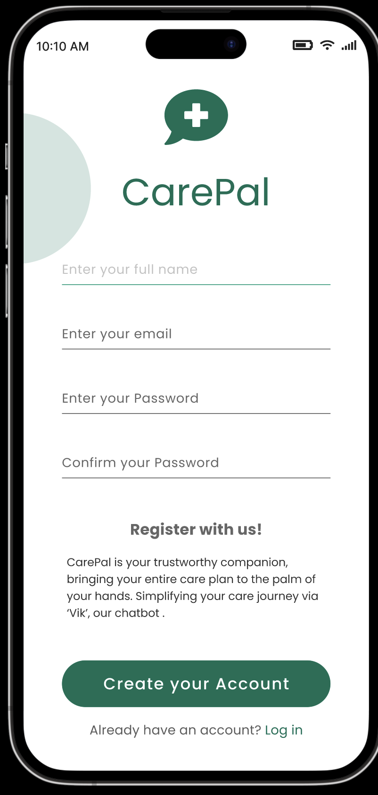
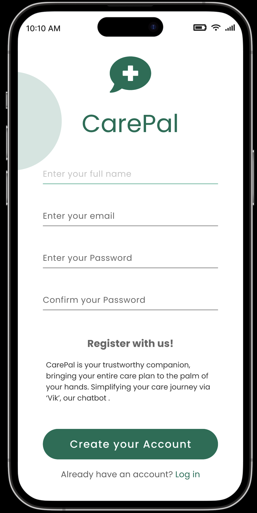
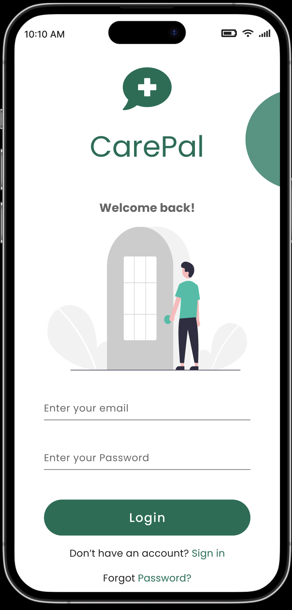
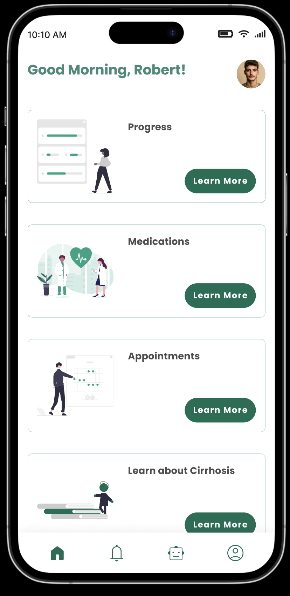
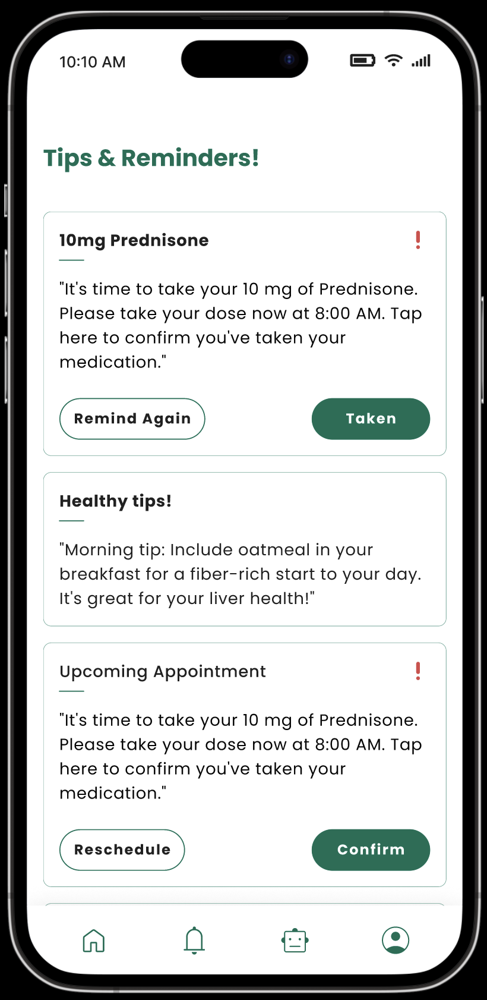
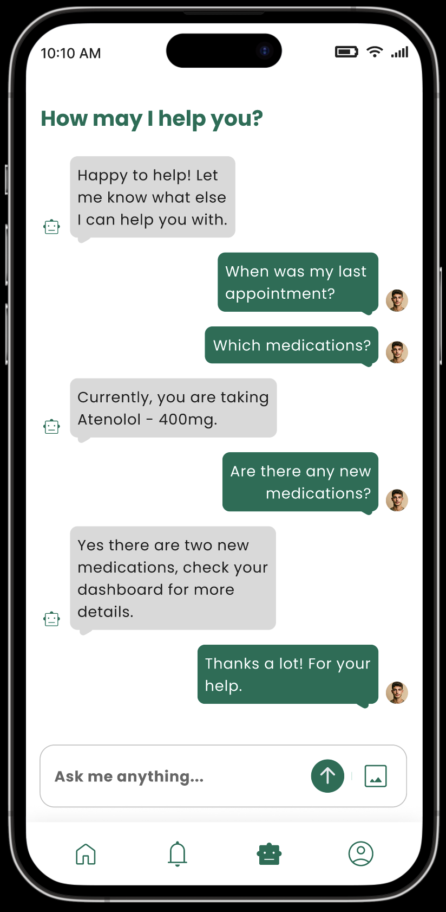
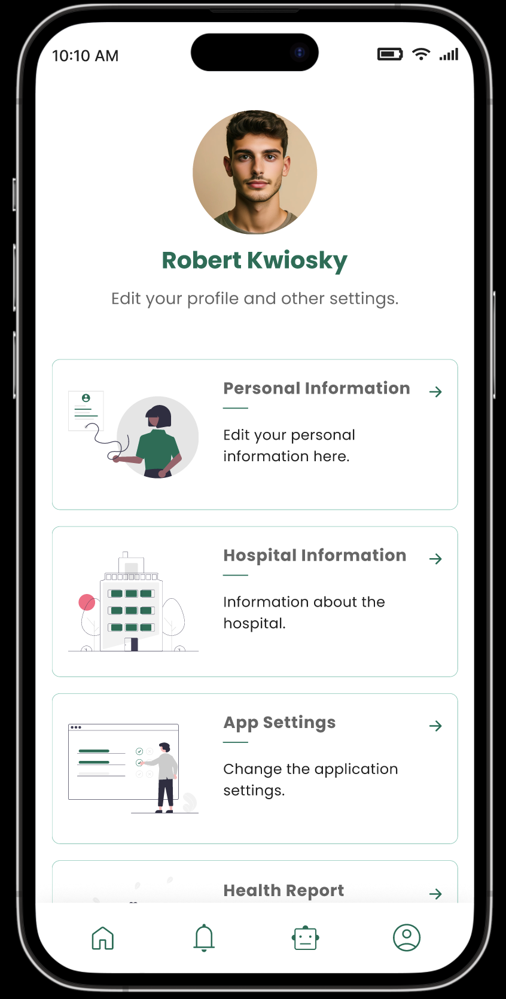
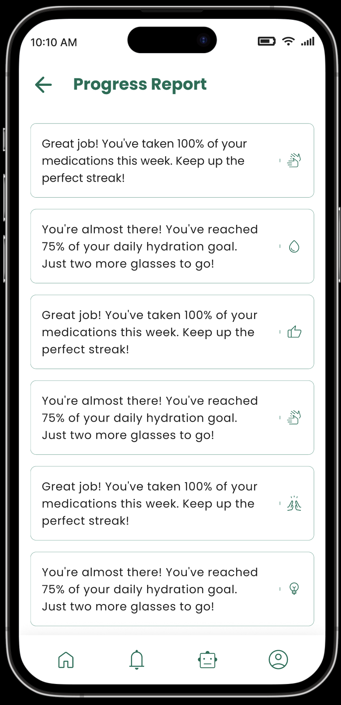
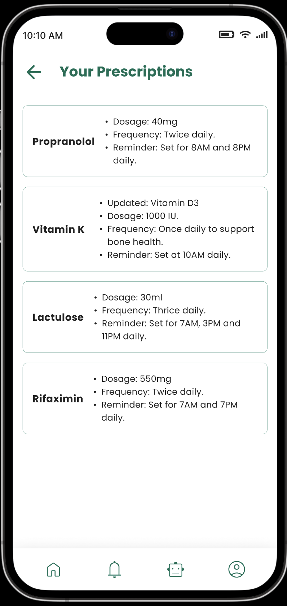
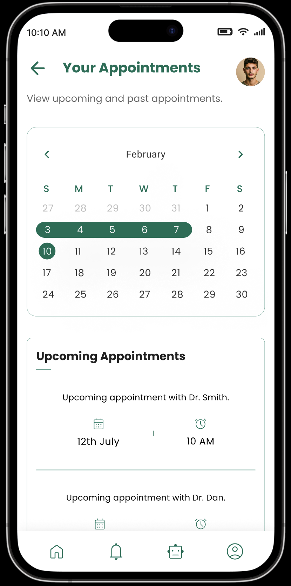
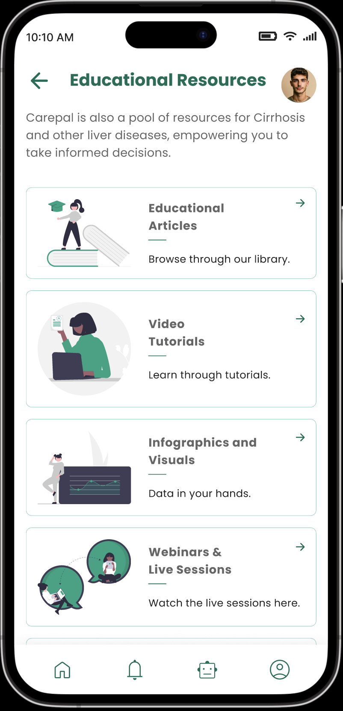
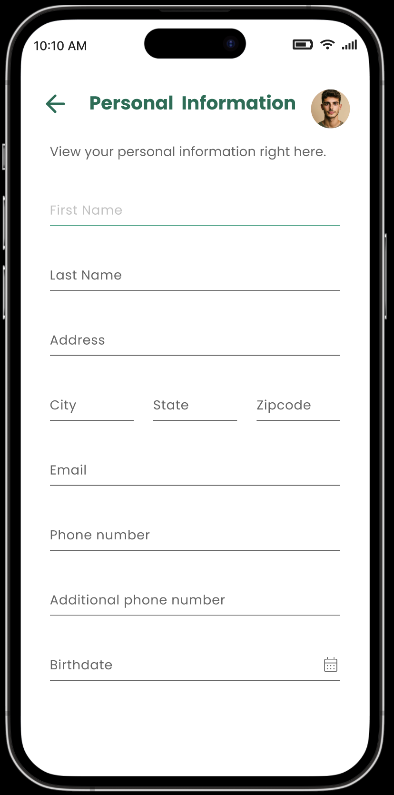

Interactive design on Figma:
https://www.figma.com/design/C8qwpsz1SIwJQVWTUX5ENF/CarePal-App?node-id=285-257&t=WM2pULc0tpSgLquc-1
</details>

## Run it

**1. Start a HAPI FHIR server** (Docker):

```bash
docker run -p 8080:8080 hapiproject/hapi:latest
# FHIR base URL: http://localhost:8080/fhir
```

**2. Load the sample patient.** POST the resources below to `http://localhost:8080/fhir/<ResourceType>` with
Postman or `curl -X POST -H "Content-Type: application/fhir+json" -d @file.json`. Post `Patient`, `Practitioner`,
and `Organization` first so the references resolve.

<details>
<summary>Sample FHIR resources (Patient, MedicationRequest, CarePlan, Condition, Observation, Encounter, Practitioner, Organization)</summary>

**Step 1: Post a Patient Resource**
```json
{
  "resourceType": "Patient",
  "id": "7",
  "name": [
    {
      "use": "official",
      "family": "Vikram",
      "given": ["Chandra"]
    }
  ],
  "gender": "male",
  "birthDate": "1965-07-14",
  "address": [
    {
      "use": "home",
      "line": ["123 Main St"],
      "city": "Indianapolis",
      "state": "IN",
      "postalCode": "46202",
      "country": "USA"
    }
  ]
}
```
**Step 2: Post a MedicationRequest Resource**
```json
{
  "resourceType": "MedicationRequest",
  "status": "active",
  "intent": "order",
  "medicationReference": {
    "reference": "Medication/10"
  },
  "subject": {
    "reference": "Patient/7"
  },
  "authoredOn": "2023-07-10T00:00:00Z",
  "requester": {
    "reference": "Practitioner/9"
  },
  "dosageInstruction": [
    {
      "text": "Take one tablet by mouth daily"
    }
  ]
}
```
**Step 3: Post a CarePlan Resource**
```json
{
  "resourceType": "CarePlan",
  "status": "active",
  "intent": "plan",
  "title": "Liver Cirrhosis Management Plan",
  "description": "A care plan for managing liver cirrhosis, including medication, diet, and regular follow-ups.",
  "subject": {
    "reference": "Patient/7"
  },
  "period": {
    "start": "2023-07-01T00:00:00Z"
  },
  "activity": [
    {
      "detail": {
        "code": {
          "coding": [
            {
              "system": "http://snomed.info/sct",
              "code": "183276004",
              "display": "Low-sodium diet"
            }
          ]
        },
        "status": "in-progress",
        "description": "Follow a low-sodium diet and monitor fluid retention."
      }
    }
  ]
}
```
**Step 4: Post a Condition Resource**
```json
{
  "resourceType": "Condition",
  "clinicalStatus": {
    "coding": [
      {
        "system": "http://terminology.hl7.org/CodeSystem/condition-clinical",
        "code": "active",
        "display": "Active"
      }
    ]
  },
  "verificationStatus": {
    "coding": [
      {
        "system": "http://terminology.hl7.org/CodeSystem/condition-ver-status",
        "code": "confirmed",
        "display": "Confirmed"
      }
    ]
  },
  "code": {
    "coding": [
      {
        "system": "http://snomed.info/sct",
        "code": "4567007",
        "display": "Liver Cirrhosis"
      }
    ]
  },
  "subject": {
    "reference": "Patient/7"
  },
  "onsetDateTime": "2023-06-01T00:00:00Z",
  "recordedDate": "2023-06-05T00:00:00Z"
}
```
**Step 5: Post an Observation Resource**
```json
{
  "resourceType": "Observation",
  "status": "final",
  "category": [
    {
      "coding": [
        {
          "system": "http://terminology.hl7.org/CodeSystem/observation-category",
          "code": "laboratory",
          "display": "Laboratory"
        }
      ]
    }
  ],
  "code": {
    "coding": [
      {
        "system": "http://loinc.org",
        "code": "1920-8",
        "display": "Serum Bilirubin"
      }
    ]
  },
  "subject": {
    "reference": "Patient/7"
  },
  "effectiveDateTime": "2023-07-15T00:00:00Z",
  "valueQuantity": {
    "value": 1.2,
    "unit": "mg/dL",
    "system": "http://unitsofmeasure.org",
    "code": "mg/dL"
  }
}
```
**Step 6: Post an Encounter Resource**
```json
{
  "resourceType": "Encounter",
  "status": "finished",
  "class": {
    "system": "http://terminology.hl7.org/CodeSystem/v3-ActCode",
    "code": "AMB",
    "display": "Ambulatory"
  },
  "subject": {
    "reference": "Patient/7"
  },
  "period": {
    "start": "2023-08-01T09:00:00Z",
    "end": "2023-08-01T10:00:00Z"
  },
  "reasonCode": [
    {
      "coding": [
        {
          "system": "http://snomed.info/sct",
          "code": "4567007",
          "display": "Liver Cirrhosis"
        }
      ]
    }
  ]
}
```
**Step 7: Post an Practitioner Resource**
```json
{
  "resourceType": "Practitioner",
  "id": "9",
  "name": [
    {
      "use": "official",
      "family": "Desai",
      "given": ["Archita"]
    }
  ],
  "qualification": [
    {
      "code": {
        "text": "MD"
      }
    }
  ]
}
```
**Step 8: Post an Organization Resource**
```json
{
  "resourceType": "Organization",
  "id": "8",
  "name": "IU Health",
  "address": [
    {
      "line": ["Hospital Drive"],
      "city": "Indianapolis",
      "state": "IN",
      "postalCode": "46202",
      "country": "USA"
    }
  ]
}
```

</details>

**3. Run the app:**

```bash
flutter pub get
flutter run
```

The app calls `Patient/7/$everything`, parses the returned bundle, and displays each resource type in its own section.

## Project layout

```
lib/
├── main.dart                 # fetch + render the $everything bundle
└── models/                   # typed FHIR resource models
    ├── fhir_types.dart
    ├── patient.dart
    ├── medication_request.dart
    ├── medication.dart
    ├── care_plan.dart
    ├── condition.dart
    ├── observation.dart
    ├── encounter.dart
    ├── organization.dart
    └── practitioner.dart
```

## Stack

Flutter · HAPI FHIR (Docker) · HL7 FHIR R4 · SNOMED CT / LOINC / UCUM

## License

MIT — see [LICENSE](LICENSE).
